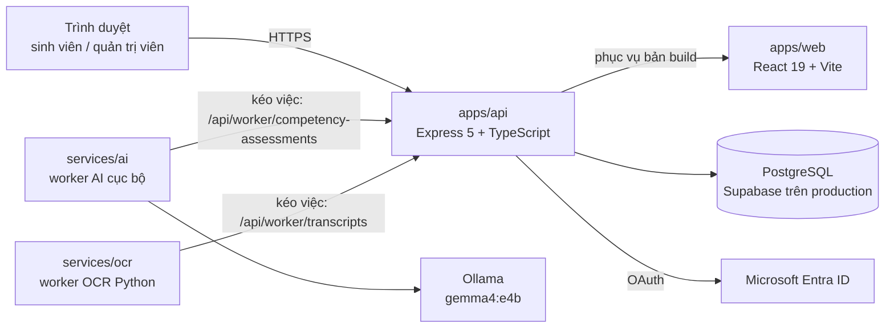
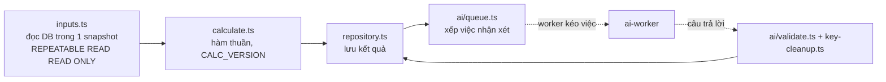
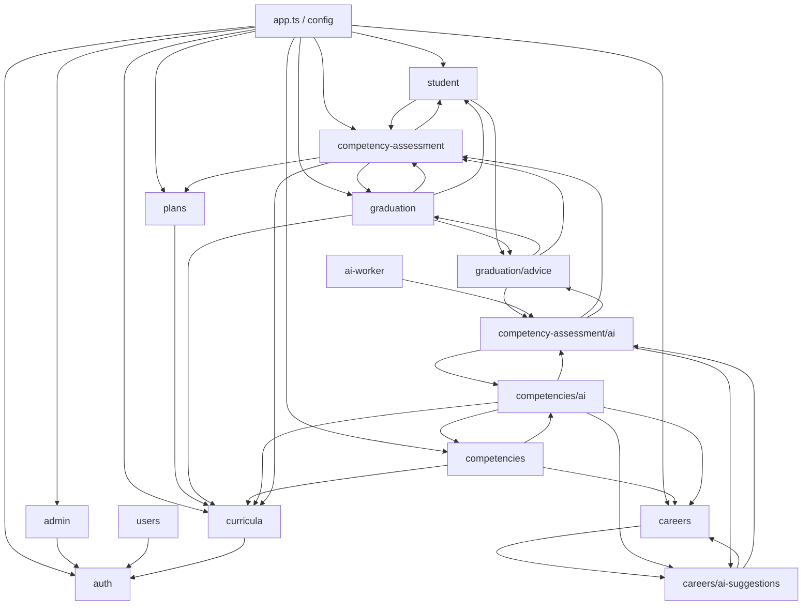

# Kiến trúc EduPath AI

Tài liệu mô tả cách mã nguồn được chia thành module, cách các phần nói chuyện với nhau và các quy ước khi thêm chức năng mới. Chi tiết nghiệp vụ của từng chức năng nằm ở các tài liệu riêng trong `docs/`; bảng ở mục 3 và mục 4 trỏ tới chúng.

Cập nhật lần cuối: 20/10/2026.

## 1. Tổng quan

EduPath AI là một monorepo npm (`workspaces: apps/*`). Hệ thống gồm:
- hai ứng dụng: API Express và web React;
- hai worker chạy cục bộ trên máy của nhóm: AI và OCR;
- các script kiểm tra tích hợp.

- **Một tiến trình phục vụ tất cả.** Trên Render, `npm run build` build cả hai app; `npm start` chạy API. API vừa trả `/api/*` vừa phục vụ `apps/web/dist`, và mọi đường dẫn còn lại trả `index.html`.
- **Không có máy AI trên server.** Worker AI chạy trên laptop của nhóm. Worker tự kéo việc từ hàng đợi trong PostgreSQL bằng khóa `AI_WORKER_KEY`, nên API không bao giờ gọi ra máy AI. Thiếu khóa thì các chức năng AI tắt, phần còn lại vẫn chạy.
- **Code tính số liệu, AI chỉ diễn giải và gợi ý.** Điểm năng lực, khoảng trống kỹ năng và xét tốt nghiệp do code tính (hàm thuần, có test). Gemma chỉ viết nhận xét và đề xuất trong danh sách do code dựng sẵn. Server kiểm tra lại mọi câu trả lời của AI trước khi lưu.

## 2. Thư mục

| Thư mục | Nội dung |
| --- | --- |
| `apps/api` | API: `src/` (mã nguồn theo module), `migrations/` (SQL đánh số), `workers/` (worker thread đọc Excel), `data/` (tệp CTĐT/KHĐT mẫu dùng cho seed). |
| `apps/web` | Giao diện: `src/` (component, hàm dữ liệu thuần, kiểu dữ liệu, CSS theo chức năng), `public/` (ảnh, logo). |
| `services/ai` | Cấu hình và script khởi động worker AI (mã worker nằm trong `apps/api/src/ai-worker`). |
| `services/ocr` | Worker OCR bằng Python (PaddleOCR) đọc PDF bảng điểm. |
| `scripts` | `verify-*.mjs` (kiểm tra tích hợp trên PostgreSQL thật, schema tạm), `setup-*-worker.mjs`, seed tài khoản demo. |
| `data/demo-accounts` | Danh sách tài khoản demo (không có dữ liệu sinh viên thật). |
| `docs` | Tài liệu từng chức năng và tài liệu này. |
| `requirements` | Danh sách chức năng (Excel) của nhóm. |

Dữ liệu sinh viên thật (bảng điểm, kết quả OCR) không bao giờ nằm trong repo: `output/` và `.env*` đã nằm trong `.gitignore`.

## 3. API (`apps/api/src`)

### 3.1 Đường đi của một request

`app.ts` dựng toàn bộ pipeline theo thứ tự:

1. `helmet` và các header bảo mật.
2. Router của worker (`/api/worker/transcripts`, `/api/worker/competency-assessments`). Các router này nằm trước bộ đọc JSON chung, tự xác thực bằng `Authorization: Bearer <khóa>` (so sánh SHA-256 + `timingSafeEqual`) và tự giới hạn kích thước body.
3. Bộ đọc JSON: 2 MB cho `/api/admin/graduation` và `/api/admin/competencies`, 100 kB cho phần còn lại.
4. `correlationId`; kiểm tra Origin cho `/api/auth` và `/api/admin`.
5. Session (`express-session` + bảng session PostgreSQL), rồi kiểm tra tài khoản còn hoạt động.
6. Router của từng module (bảng 3.2). Quyền được kiểm tra trong router bằng `middleware/authorization.ts` và lại trong transaction ghi (`access(..., true)`).
7. Static web + fallback `index.html`; 404 JSON cho `/api/*`; `errorHandler`.

`server.ts` đọc cấu hình (`config.ts`), chạy migration khi `DATABASE_AUTO_MIGRATE=true` rồi mới mở cổng. Không có `DATABASE_URL` thì chạy chế độ xem thử: người dùng và session lưu trong bộ nhớ.

### 3.2 Module

| Đường dẫn API | Module | Trách nhiệm | Tài liệu |
| --- | --- | --- | --- |
| `/api/auth` | `auth/` | Đăng nhập Microsoft Entra ID (MSAL), session, nhật ký đăng nhập | `SPRINT_2_ADMIN_AUTH.md` |
| — | `users/` | Kho người dùng: PostgreSQL hoặc bộ nhớ (chế độ xem thử) | |
| `/api/admin/accounts`, `/api/admin/students` | `admin/` | Tài khoản quản trị, phân quyền, khóa/mở; hồ sơ sinh viên | `ADMIN_GLOBAL_SCOPE.md`, `SPRINT_2_STUDENT_PROFILES.md` |
| `/api/student` | `student/` | Hồ sơ, bảng điểm (PDF → OCR → JSON), đồng ý xử lý dữ liệu | `student-transcripts.md`, `STUDENT_WORKSPACE.md` |
| `/api/admin/curricula`, `/api/student/curricula` | `curricula/` | Chương trình đào tạo: nhập Excel, phiên bản, học phần, quan hệ tiên quyết | `curriculum-guide.md` |
| `/api/admin/plans`, `/api/student/plans` | `plans/` | Kế hoạch đào tạo theo khóa | `training-plan-guide.md`, `student-plans.md` |
| `/api/admin/graduation`, `/api/student/graduation` | `graduation/` | Tiêu chuẩn xét tốt nghiệp; đánh giá cho từng sinh viên (`evaluation.ts`, thuần) | `graduation-standards.md` |
| `/api/student/graduation/advice` | `graduation/advice/` | Lời khuyên tốt nghiệp do AI viết, tự xếp hàng theo dấu vân tay dữ liệu | `graduation-advice.md` |
| `/api/admin/careers`, `/api/student/careers` | `careers/` | Lĩnh vực, kỹ năng (danh mục dùng chung), nghề nghiệp, yêu cầu kỹ năng | `career-positions.md` |
| `/api/admin/careers/requirements/ai-suggestions` | `careers/ai-suggestions/` | AI đề xuất kỹ năng cho nghề nghiệp | `career-ai-suggestions.md` |
| `/api/admin/competencies` | `competencies/` | Nhóm năng lực, cấu hình năng lực, cấu hình môn học (môn học dùng chung cho mọi khóa, migration 038; liên kết + trọng số) | `competency-management.md` |
| `/api/admin/competencies/ai` | `competencies/ai/` | AI tạo liên kết kỹ năng kèm trọng số; chạy AI cho các môn chưa có liên kết | `competency-management.md` |
| `/api/student/competency-assessments` | `competency-assessment/` | Đánh giá năng lực, khoảng trống kỹ năng, tiến độ, lịch sử theo học kỳ | `competency-assessment.md` |
| `/api/worker/competency-assessments` | `competency-assessment/ai/` | Nhận xét AI cho sinh viên; **cửa chung của worker AI** cho mọi loại việc | `competency-assessment.md` |
| — | `ai-worker/` | Mã worker AI chạy trên máy cục bộ (`npm run ai-worker`): client, Ollama, vòng lặp | `services/ai/README.md` |
| — | `db/`, `session/`, `middleware/` | Pool PostgreSQL, migration, session store, phân quyền | |

### 3.3 Cấu trúc bên trong một module

Mỗi module nghiệp vụ dùng cùng một khuôn:

| Tệp | Vai trò |
| --- | --- |
| `router.ts` | HTTP: kiểm tra input bằng `zod` (`.strict()`), quyền, mã lỗi; chuyển `ZodError` và lỗi riêng của module thành JSON `{ error: "<mã>" }`. |
| `repository.ts` | SQL qua `pg`, transaction, khóa (`FOR UPDATE`, advisory lock), token phiên bản `x-version` chống ghi đè. |
| `model.ts` | Schema `zod`, kiểu dữ liệu, lớp lỗi (`CompetencyError`, `CareerError`…). |
| `parser.ts`, `seed.ts`, `seed-cli.ts` | Nhập Excel (chạy trong `apps/api/workers/*.mjs` để không chặn event loop) và seed. |
| `ai/prompt.ts` | Dựng prompt và JSON schema cho Gemma; hàm thuần, có test. Chỉ gửi dữ liệu cần thiết, không gửi dữ liệu cá nhân. |
| `ai/validate.ts` | Kiểm tra câu trả lời của AI: schema, khóa hợp lệ, không bịa số, không link/HTML; hàm thuần, có test. |
| `ai/jobs.ts` | Hàng đợi: xếp việc, claim, gia hạn lease, hoàn tất, hết hạn (SQL). |

Ranh giới quan trọng nhất là **tính toán thuần tách khỏi I/O**:

`calculate.ts`, `graduation/evaluation.ts`, `competency-assessment/graduation.ts`, `plan-progress.ts` và mọi `ai/prompt.ts`, `ai/validate.ts` không đọc DB hay mạng. Nhờ vậy test được bằng dữ liệu tổng hợp (`fixtures/`, `test-fixture.ts`) và kết quả lặp lại được. Mỗi lần đổi cách tính phải tăng `CALC_VERSION`; mỗi lần đổi prompt phải tăng `PROMPT_VERSION` hoặc `COURSE_AI_PROMPT_VERSIONS`. Phiên bản được lưu kèm kết quả.

### 3.4 Worker AI và hàng đợi

- **Bốn loại việc** (`AI_JOB_KINDS` trong `competency-assessment/ai/worker-protocol.ts`):
  - `competency_assessment`: nhận xét năng lực;
  - `career_skill_suggestion`: kỹ năng cho nghề nghiệp;
  - `graduation_advice`: lời khuyên tốt nghiệp;
  - `competency_course_suggestion_v2`: liên kết kỹ năng và trọng số cho học phần.
- **Một cửa chung.** Mỗi loại việc có bảng hàng đợi riêng trong module của nó (`*/ai/jobs.ts`). Worker chỉ gọi `/api/worker/competency-assessments/{heartbeat,claim,:id/extend,:id/complete}`. Router chung hỏi lần lượt từng hàng đợi theo thứ tự ưu tiên: đề xuất kỹ năng, lời khuyên tốt nghiệp, nhận xét năng lực, rồi việc của học phần.
- **Worker báo loại việc nó biết** trong `heartbeat`/`claim`. Thêm loại việc mới hoặc đổi giao thức thì phải khởi động lại worker trên laptop. Đổi prompt hay schema thì không cần, vì worker chỉ chuyển nguyên prompt sang Ollama.
- **Lease 15 phút, tối đa 2 lần thử.** Việc chờ quá 24 giờ thành `worker_timeout`. `ai_input` bị xóa khi việc kết thúc. Câu trả lời sai định dạng thành `invalid_ai_output` và không bao giờ hiển thị.
- **Chế độ suy luận.** Job gửi `think: true` cho các việc cần chất lượng (nhận xét năng lực, việc của học phần). Ollama luôn nhận `num_ctx` 16384 để không phải nạp lại mô hình.

### 3.5 Phụ thuộc giữa các module

Mũi tên A → B nghĩa là A import B (đo bằng import tương đối, không tính test):

Mọi module đều dùng `db/` và `middleware/` (không vẽ). Có các vòng phụ thuộc đã biết, đều chạy được vì import ở mức hàm chứ không chạy lúc nạp module:
- `competency-assessment` ↔ `graduation`, vì cả hai dùng chung lõi xét tốt nghiệp;
- `student` → `competency-assessment`, vì xóa bảng điểm phải xóa kết quả đánh giá;
- `competency-assessment/ai` ↔ các `*/ai`, vì đây là cửa chung của worker.

Khi thêm code, không tạo thêm vòng mới. Phần dùng chung nên tách thành hàm thuần ở module thấp hơn.

### 3.6 Cơ sở dữ liệu và migration

- `apps/api/migrations/NNN_ten.sql` chạy theo số. Runner (`db/migrate.ts`) ghi checksum từng tệp vào `schema_migrations` và **từ chối khởi động nếu một tệp đã chạy bị sửa**.
- Không bao giờ sửa migration đã lên production. Muốn thay đổi thì thêm số tiếp theo (hiện là 039).
- Production tự chạy migration khi deploy (`DATABASE_AUTO_MIGRATE=true`); server chỉ mở cổng sau khi chạy xong.
- Bảng mới bật Row Level Security và thu quyền của `anon`/`authenticated`/`service_role`, theo mẫu ở `034_competency_ai_suggestions.sql`.
- Có phần được **giữ lại dù không còn dùng**, vì production đã chạy và xóa sẽ làm lệch lịch sử migration:
  - cột của 033 (`runner`, `scoring_mode`, `ai_scoring`);
  - chế độ `skills` của 035/036;
  - bảng `ad_comp_skill_field_groups` của 037 (tính năng đã hoàn tác);
  - các bảng `ad_comp_import_*` của phần nhập Excel đã xóa.

## 4. Web (`apps/web/src`)

### 4.1 Định tuyến và cổng

`main.tsx` → `App.tsx`; `routing.ts` chọn trang theo đường dẫn:

| Đường dẫn | Thành phần | Ghi chú |
| --- | --- | --- |
| `/` | `LandingPage` | Trang giới thiệu công khai; FAQ và chính sách ở `PublicInformationPage`. |
| `/login` | `App.tsx` | Đăng nhập Microsoft. |
| `/dashboard#<trang>` | `StudentWorkspace` | Cổng sinh viên. Các trang chọn bằng hash: tổng quan, hồ sơ và bảng điểm, đánh giá năng lực, khoảng trống kỹ năng, nghề nghiệp, CTĐT, kế hoạch, tốt nghiệp. `StudentCompetency` được nạp lười (`lazy`). |
| `/quantri/*` | `AdminPortal` → `AdminWorkspace` | Cổng quản trị. Thanh bên và tiêu đề trang lấy từ `admin-navigation.ts` (nhóm Quản lý nghề nghiệp, Quản lý năng lực). |

Vai trò quyết định cổng duy nhất của mỗi người dùng; email `@vlu.edu.vn` chỉ vào cổng quản trị khi đã được cấp quyền.

### 4.2 Các lớp trong mã web

| Lớp | Tệp | Quy ước |
| --- | --- | --- |
| Trang / component | `*Management.tsx` (quản trị), `Student*.tsx` (sinh viên), `Competency*.tsx`, `Career*.tsx` | Chỉ hiển thị và gọi API. Không tự tính nghiệp vụ. |
| Hàm dữ liệu thuần | `student-competency-data.ts`, `student-graduation-data.ts`, `student-overview-data.ts`, `student-plan-results.ts`, `transcript-results.ts`, `competency-ai.ts`, `competency-weights.ts`, `form-checks.ts`, `curriculum-credits.ts` | Không đụng DOM; mọi câu chữ và phép đổi số cho người dùng nằm ở đây, có unit test. |
| Kiểu API | `*-types.ts` | Đi kèm hình dạng JSON của API tương ứng; trường mới để tùy chọn (`?`) khi kết quả cũ chưa có. |
| Hook | `use-live-data.ts` (tải và tải lại theo khóa), `use-live-filters.ts` (bộ lọc + phân trang), `use-competency-suggestion.ts` (theo dõi một đề xuất AI) | |
| UI dùng chung | `admin-ui.tsx` (`Modal`, `ActionMenu`, `Status`, `Pagination`), `CheckedForm.tsx` (kiểm tra form, thông báo tiếng Việt), `ui-icon.tsx`, `EduPathBrand.tsx` | Form quản trị dùng `CheckedForm` thay cho `<form>` (xem `admin-form-checks.md`). |
| CSS | một tệp cho mỗi chức năng (`competencies.css`, `student-competency.css`…) + `ui-controls.css` (nút, ô nhập, thông báo dùng chung) + `styles.css` (nền chung) | Tên lớp có tiền tố theo chức năng: `cm-` quản trị chung, `comp-` năng lực, `scomp-` năng lực sinh viên, `sg-` tốt nghiệp, `sw-`/`sr-` cổng sinh viên, `am-` khung quản trị, `lp-` trang giới thiệu, `cai-` hộp thoại AI. |

Test web chạy trong môi trường node: hàm thuần được test trực tiếp, component được render bằng `renderToStaticMarkup` với dữ liệu giả lập (`*.fixture.ts`). Hành vi trong trình duyệt thật (form, bảng) được kiểm tra thêm bằng Edge headless khi cần.

## 5. Kiểm thử và kiểm tra

| Loại | Lệnh | Phạm vi |
| --- | --- | --- |
| Typecheck | `npm run typecheck` | Cả hai app. |
| Unit | `npm test` | Vitest: `apps/api/src/**/*.test.ts`, `apps/web/src/**/*.test.ts(x)`. |
| Tích hợp | `npm run build -w @edupath/api && node scripts/verify-<tên>.mjs` | Router thật trên PostgreSQL cục bộ trong một schema tạm, tự xóa khi xong; schema `public` không đổi. `verify-competency-assessment.mjs --with-ollama` chạy thêm một việc AI thật. |
| Code thừa | `npx knip` (cấu hình đặt trong lệnh, không lưu trong repo) | Tệp, export, phụ thuộc không dùng. |

Các script `verify-*.mjs` import từ `apps/api/dist` nên phải build API trước. Script dùng `dotenv`, `pg`, `express` có sẵn trong workspace sau `npm install` ở thư mục gốc.

## 6. Triển khai

- `render.yaml`: một Web Service Node 22.
  - build: `npm ci --include=dev && npm run build`;
  - start: `npm start`;
  - health check: `/api/health`.
- Biến bí mật (`DATABASE_URL`, `ENTRA_*`, `AI_WORKER_KEY`, `OCR_WORKER_KEY`, `SESSION_SECRET`) đặt trên Render với `sync: false`, không bao giờ nằm trong repo.
- Mỗi commit đẩy lên `main` được Render deploy tự động.
- Worker AI và OCR chạy trên máy cục bộ và trỏ `AI_API_URL` / `OCR_API_URL` về production.

## 7. Thêm một chức năng mới

1. Đặt code vào module có sẵn nếu đúng nghiệp vụ. Nếu không, tạo thư mục mới trong `apps/api/src` theo khuôn `router.ts` / `repository.ts` / `model.ts`, rồi gắn router trong `app.ts` với tiền tố `/api/admin/...` hoặc `/api/student/...`.
2. Phần tính toán viết thành hàm thuần, kèm test và hằng phiên bản nếu kết quả được lưu.
3. Thay đổi bảng thì thêm migration số tiếp theo, một lần, đầy đủ, có RLS.
4. Việc AI mới:
   - thêm hàng đợi `ai/jobs.ts` trong module;
   - thêm loại việc vào `worker-protocol.ts` và router chung;
   - prompt/validate thuần, có test;
   - ghi trong tài liệu rằng worker phải khởi động lại.
5. Web: kiểu API trong `*-types.ts`, logic hiển thị trong hàm thuần có test, component chỉ ghép lại; form dùng `CheckedForm`.
6. Thêm hoặc cập nhật tài liệu trong `docs/` và bảng ở mục 3.2.

## 8. Dọn dẹp ngày 20/10/2026

- **Tìm bằng knip** (tệp, export, phụ thuộc) **và `tsc --noUnusedLocals`.** Không còn tệp nguồn nào thừa.
  - Xóa 9 khai báo không được dùng ở đâu cả. Ví dụ: `NOT_APPLICABLE_LABELS`, `numberSet`, các kiểu `SkillInput`/`GroupInput`/`ConfigurationInput`.
  - Bỏ từ khóa `export` của khoảng 175 hằng, hàm và kiểu chỉ dùng trong chính tệp của chúng.
  - Xóa một re-export không ai dùng trong `worker-router.ts`, import `Response` thừa trong `auth/router.ts`, và hàm `exportJson` của trang bảng điểm (không gắn với nút nào).
- **Xóa 513 dòng CSS** của 37 lớp không còn component nào dùng: khung dashboard cũ, thương hiệu cũ của trang quản trị và trang giới thiệu, `ep-text-action`… Các danh sách selector chỉ bớt đúng lớp thừa.
- **Xóa** `apps/web/public/favicon.svg`, `apps/web/public/vlu-logo.png` (không trang nào dùng) **và** cấu hình coverage của vitest (gói `@vitest/coverage-v8` chưa từng được cài, không lệnh nào chạy coverage).
- **Sửa `scripts/verify-career-ai-suggestions.mjs`.** Script thiếu migration 033–036 nên `/claim` báo lỗi bảng `ad_comp_ai_suggestions`. Lỗi này có từ khi thêm 034. Kết quả sau khi sửa: 16/16.
- **Giữ lại có chủ ý:**
  - các migration và cột, bảng không dùng ở mục 3.6;
  - chế độ AI `weights` (đề xuất cũ vẫn mở được);
  - tài liệu Sprint 2 (lịch sử).
